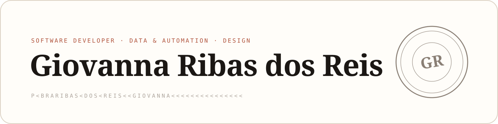
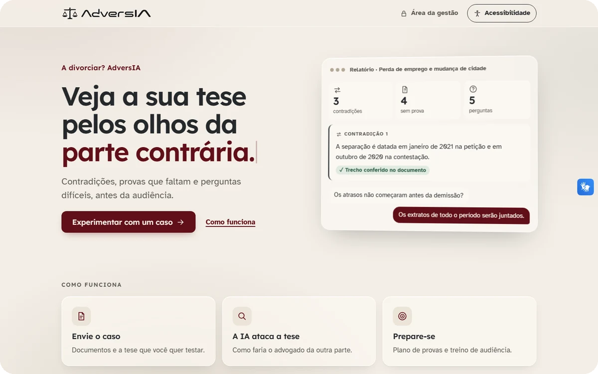
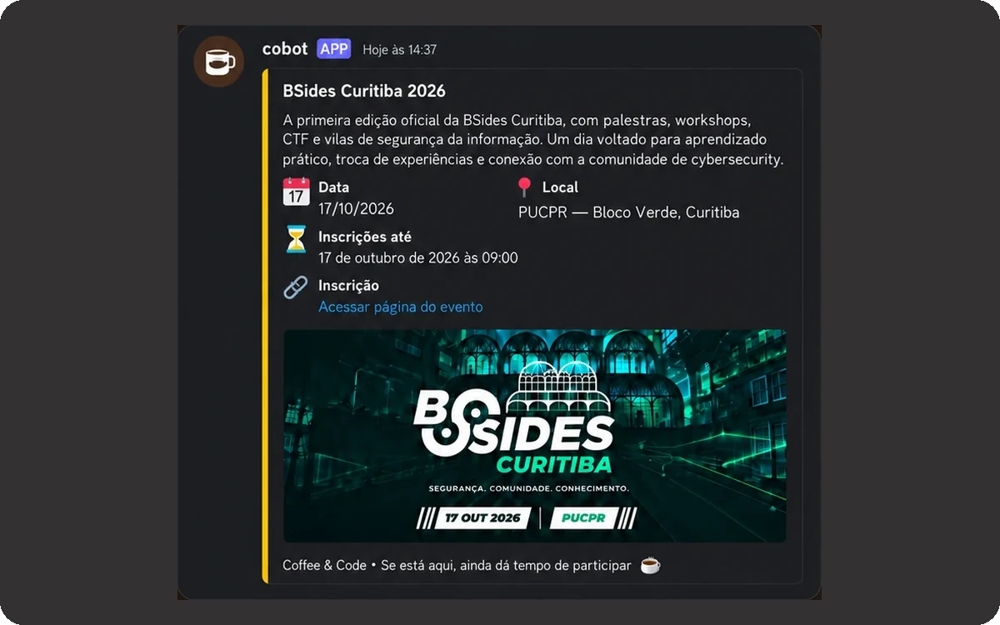
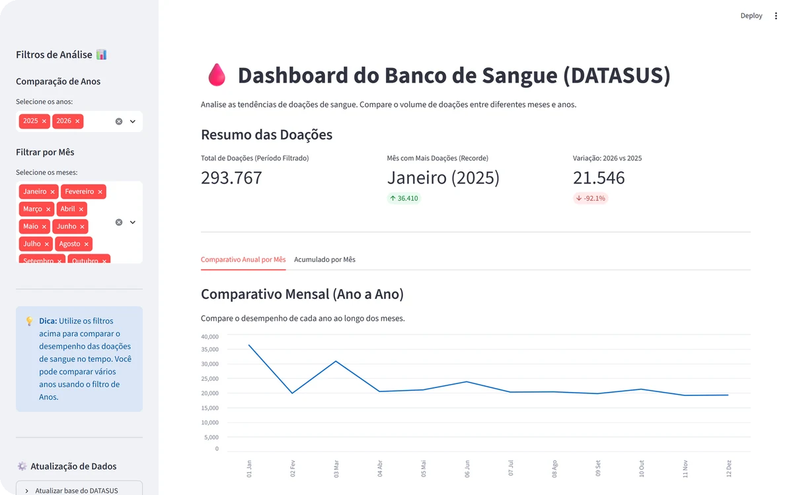
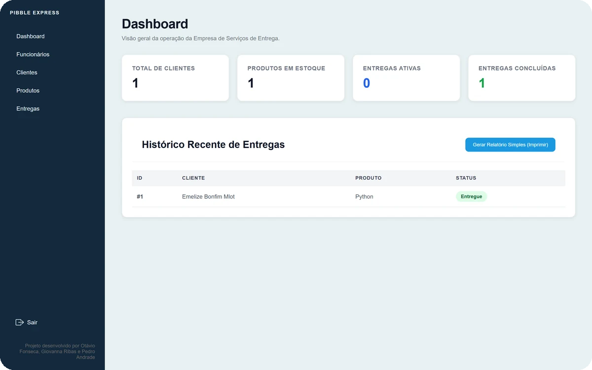

<picture>
  <source media="(prefers-color-scheme: dark)" srcset="assets/banner-dark.svg">
  
</picture>

<b>Estudante de Engenharia de Software &nbsp;&middot;&nbsp; Desenvolvedora de Software</b>

<a href="https://github.com/ribasgiovanna">English</a> &nbsp;&middot;&nbsp; Português

  Estudante de Engenharia de Software na PUCPR, atuando entre software, dados e design. 
  Construo pipelines de ETL e rotinas de tratamento de dados, substituo processos manuais 
  e sujeitos a erro por automação e desenvolvo aplicações web e interativas &mdash; 
  com uma base em design visual e identidade digital.

---

## Áreas de atuação

- **Desenvolvimento de software** - Aplicações web full stack com autenticação, controle de acesso por perfil, persistência de dados e integração de APIs
- **Dados e automação** - Pipelines de ETL, tratamento de dados e RPA que trocam trabalho manual e sujeito a erro por processos confiáveis
- **Aplicações interativas** - Lógica de jogos e programas orientados a estados
- **Design** - Identidade visual e design de interfaces, aplicados em todas as áreas acima

---

## Tecnologias

  &nbsp;&nbsp;
  &nbsp;&nbsp;
  &nbsp;&nbsp;
  &nbsp;&nbsp;
  &nbsp;&nbsp;
  &nbsp;&nbsp;
  &nbsp;&nbsp;
  &nbsp;&nbsp;
  &nbsp;&nbsp;
  &nbsp;&nbsp;
  &nbsp;&nbsp;

**Principais** - o que uso no dia a dia, no trabalho e nos meus principais projetos
- Python | TypeScript / JavaScript | SQL
- FastAPI | Django | Django REST Framework | Next.js | HTML | CSS
- pandas | SQL Server | PostgreSQL | MongoDB
- Git & GitHub | Docker

**Aplicadas em projetos** - usadas para construir e publicar projetos específicos
- Selenium (RPA) | Streamlit | SQLite | discord.py | Pygame | APIs de LLM
- Linux (systemd) | Oracle Cloud | Vercel | Windows Server

**Explorando no momento**
- Tailwind CSS

**Design e ferramentas criativas**
- Figma | Canva | Photoshop | Lightroom | Procreate | Affinity | Blender

---

## Projetos em destaque

<table>
<tr>
<td width="50%" valign="top">

### [AdversIA](https://github.com/ribasgiovanna/AdversIA) · [demonstração](https://adversia.vercel.app)

Assistente com IA para advogados de Direito de Família, que analisa o caso pelos olhos da parte contrária. Criado no Hackathon OAB/PR 2026.

**Resultado:** 32 casos de demonstração e testes automatizados

*Projeto em equipe · minha parte: back-end e front-end*

`Python` `LLM` `Vercel` `JavaScript`

</td>
<td width="50%" valign="top">

### [Cobot](https://github.com/ribasgiovanna/cobot)

Bot de Discord que publica os eventos do Coffee &amp; Code e remove cada post quando a inscrição encerra, rodando 24/7 na Oracle Cloud.

**Resultado:** em produção, 5 etapas manuais viraram 1 comando

*Projeto individual*

`Python` `SQLite` `Linux` `Oracle Cloud`

</td>
</tr>
<tr>
<td width="50%" valign="top">

### [Bloody Mary](https://github.com/ribasgiovanna/datasus)

Extração automatizada (RPA) de dados públicos de hemoterapia do DATASUS, com execução paralela, checkpoints e dashboard.

**Resultado:** execuções que retomam do checkpoint após falhas

*Projeto em equipe · minha parte: ideia, extração e tratamento*

`Python` `Selenium` `pandas` `Streamlit`

</td>
<td width="50%" valign="top">

### [Pibble Express](https://github.com/ribasgiovanna/pibble_express)

Sistema web em Django para gestão de entregas, com autenticação, acesso por perfil, CRUD completo e API REST em todos os módulos.

**Resultado:** controle de acesso coberto por 21 testes

*Projeto em equipe · minha parte: funcionários e dashboard*

`Python` `Django` `DRF` `SQLite`

</td>
</tr>
</table>

---

## Outros projetos

- **[Corrida para a Faculdade](https://github.com/ribasgiovanna/jogo-atrasado-para-a-faculdade)** - jogo 2D em Python e Pygame: máquina de estados, física de pulo e dificuldade progressiva.
- **[Automação Dados Saúde](https://github.com/ribasgiovanna/automacao-dados-saude)** - limpeza e padronização de dados do DATASUS com pandas.
- **[Netflix Dados](https://github.com/ribasgiovanna/netflix-dados)** - estudo de ETL: consolida planilhas, extrai a campanha dos links UTM e gera CSV/XLSX.
- **[Curitibars](https://github.com/ribasgiovanna/Curitibars)** (projeto em equipe) - site estático em HTML/CSS: um guia de bares de Curitiba.

---

## Comunidade e impacto

- **Coffee & Code** - Fundadora e diretora executiva, responsável por estruturar o clube universitário de tecnologia.
- **Diretoria da Mulher (PUCPR)** - Coordenadora de eventos: organização de eventos, comunicação e iniciativas de impacto social.
- **Teia do Bem** - Mídias sociais, apoiando a comunicação e a divulgação do projeto.

Também contribuo com iniciativas voluntárias e projetos que geram impacto positivo
por meio da criatividade, da comunicação e da tecnologia.

---

<i>Transformando dados em clareza, ideias em interfaces e tecnologia em algo humano.</i>

